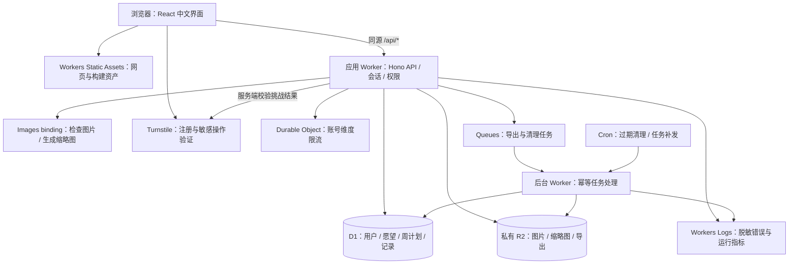

# 心流显化｜Cloudflare 全站架构设计

日期：2026-11-03（北京时间）

状态：用户已确认按此架构开发；本机实现与验收见 app/README.md。云资源按用户要求保留 TODO，未创建或部署。

用户已选择：**全站 Cloudflare，按功能分期接入**。

## 1. 目标与依据

让每位用户拥有可以长期保存的私人电子本：看见愿望、安排本周行动、留下此刻的感受，再逐步开放信念成长、会员内容和 AI。

本方案在原《心流显化-第一批开发计划》的业务范围上更换基础设施。业务需求以原计划和优化版设计为参考；用户本轮确认的 Cloudflare 技术方向优先。原文档中面向 agent 的执行说明属于附件内容，不作为额外的用户授权。

**基础设施统一使用 Cloudflare；前端采用 React + TypeScript + Vite，接口采用 TypeScript + Hono。** 这些框架属于应用代码，不需要另外租服务器、数据库或对象存储。GitHub 私有仓库仅用于源码与协作，不承载业务数据。

首批交付：用户名密码注册登录、一次性恢复码、私人图片、自由愿望画布、每周目标与打卡、日期书写、完整个人导出、保存反馈与账号隔离。本轮设计不增加支付、AI 或素材未就绪的音频。

## 2. 方案选择

| 方案 | 对本项目的影响 | 结论 |
| --- | --- | --- |
| 原计划：Node/Fastify + 本地 SQLite + 本地文件 | 本机开发直接，但上线后要自行管理服务器和文件备份；与本轮技术方向不一致 | 保留参考，不作为新实现目标 |
| Cloudflare：Workers Static Assets + API + D1 + 私有 R2 | 前后端同源，业务数据和文件均走 Cloudflare；本机使用相同运行时接口 | **采用，按功能分期接入** |
| 首批铺开所有 Cloudflare 产品及微服务 | 对当前单人记录场景增加配置、费用和排障工作，AI、视频等业务尚未进入首批 | 相关产品纳入后续蓝图，有对应功能才启用 |

第二项的采用来自用户本轮选择；下文的具体库、接口和安全参数是工程设计建议，等待整份方案确认。

## 3. 总体架构



第一批只设两个部署单元：对外应用 Worker、内部后台任务 Worker。后台 Worker 不开放公共 HTTP 入口，通过队列和定时触发工作。采用官方 Cloudflare Vite 插件，使开发服务运行于 Workers 运行时；不建立常驻 Fastify 服务。[Cloudflare Vite 插件](https://developers.cloudflare.com/workers/vite-plugin/)

网页、API、私人文件都通过同一站点域名访问。`/api/*` 必须先进入 Worker，未知 API 返回 JSON 404；SPA 回退只处理网页导航，防止把鉴权失败或缺失 API 伪装成首页。[Static Assets 路由](https://developers.cloudflare.com/workers/static-assets/routing/worker-script/)

## 4. Cloudflare 产品怎么使用

“首批”表示纳入第一批的代码、配置和本地测试；真正启用云资源仍是独立上线步骤。

| 产品或能力 | 本项目用途 | 接入时机 |
| --- | --- | --- |
| Workers + Static Assets | React 网页、同源 API、私人文件授权读取 | 首批 |
| D1 | 关系数据、会话、幂等请求和版本冲突控制 | 首批 |
| R2（私有） | 原图、缩略图、导出归档；后续存音频 | 首批 |
| Images binding | 检查真实图片格式和尺寸，生成固定尺寸缩略图 | 首批；远端能力单独验收 |
| Turnstile | 注册、恢复密码的反滥用；登录按风险追加 | 首批；本机用官方测试方案 |
| Workers Rate Limiting binding | 接口的快速近似限流 | 首批；精确安全计数另用 DO |
| Durable Objects（DO） | 对规范化账号键实施全局一致的短期验证尝试限额 | 首批；协同画布不是首批 |
| Queues + 死信队列 | 个人导出、失败重试、后台清理 | 首批 |
| Cron Triggers | 补发任务、释放过期上传、删除过期导出 | 首批；备份调度第二批扩展 |
| Workers Secrets | 保存服务端秘密；本地用未入库的 `.dev.vars` | 首批 |
| Workers Logs / Metrics | 脱敏日志、错误率、CPU、任务积压观测 | 首批；云端验证在上线阶段 |
| D1 Time Travel | 数据库时间点恢复的运营能力 | 上线时核对；第二批做恢复演练 |
| DNS / TLS / Cache Rules / WAF | 自有域名、安全访问、公开静态内容缓存及应用防护 | 确认上线后，按套餐可用能力配置 |
| Workers Builds | 关联 GitHub 私有仓库，测试和构建后发布 | 确认上线后；生产迁移单独受控 |
| Cloudflare Access | 独立管理员后台外层身份门禁 | 第三批；应用仍验证管理员角色 |
| Workers KV | 允许短暂陈旧的公开分类和展示配置缓存 | 第三批，确有缓存收益才启用 |
| Workflows | 导入恢复、跨步骤备份及长任务编排 | 第二批评估，简单导出仍用 Queues |
| Workers AI + AI Gateway | 经用户同意后生成复盘、排版建议；治理 AI 请求与用量 | AI 独立批次 |
| Vectorize | 仅对已授权资料做语义检索 | AI 独立批次 |
| Stream | 如果将来推出视频课程，提供视频处理与播放 | 有视频业务时；普通冥想音频优先 R2 |

第一批的付费能力和远端资源未获开通授权。配置不以“全部免费”为前提，也不在未完成的页面展示可点击的假功能。

后续 AI、向量和工作流的产品能力参考：[Workers AI](https://developers.cloudflare.com/workers-ai/)、[AI Gateway](https://developers.cloudflare.com/ai-gateway/)、[Vectorize](https://developers.cloudflare.com/vectorize/)、[Workflows](https://developers.cloudflare.com/workflows/)、[Stream](https://developers.cloudflare.com/stream/)。

## 5. 账号、会话与权限

### 5.1 普通用户

- 保留用户名加密码，不要求 Cloudflare 账户，不强制邮箱或手机号。
- 用户名 3–32 字符；采用 NFKC 规范化、首尾去空白和统一大小写后的登录名做唯一索引；另存显示名。密码 12–128 字符，**不修剪、不规范化密码**。
- 首选维护中的 Workers 可用 Argon2id WASM 实现，参数下限 `memory=19456 KiB, iterations=2, parallelism=1`，随机盐至少 16 字节，输出至少 32 字节；保存算法和参数版本以便升级。按 [OWASP 密码存储建议](https://cheatsheetseries.owasp.org/cheatsheets/Password_Storage_Cheat_Sheet.html)执行。
- 实施前先做 Workers 运行时兼容性与并发内存测试，再锁定依赖版本。每个 isolate 同时最多进行两次 KDF；超过时返回可重试的繁忙错误。库初始化与 WASM 内存重用必须进入测试，不因免费额度降低散列强度。
- 恢复码为随机至少 32 字节，首次注册或恢复成功时展示一次。D1 只存恢复码摘要；重置时原子消费旧码、增加凭据版本、使旧会话失效并签发新恢复码。改密要求原密码，不能仅凭用户名更改。
- 会话令牌随机至少 32 字节，仅将其摘要存入 D1；生产 Cookie 使用 `__Host-flow_session`、`Secure`、`HttpOnly`、`SameSite=Lax`、`Path=/`，不设置 Domain。会话默认 7 天，改密/恢复/删除账号时可撤销。
- 写请求验证同源 Origin 和 CSRF token；注册、登录、恢复也做来源验证。开发专用的本机 Cookie 配置不可沿用到生产。

Workers 的内存和 CPU 有平台限制；付费与免费套餐的 CPU 额度不同。登录散列、图片处理及导出必须在 Workers 中验证，不能以 Node.js 单元测试代替兼容性证据。[Workers 限制](https://developers.cloudflare.com/workers/platform/limits/)

### 5.2 反滥用

Turnstile 在服务端调用 Siteverify，校验成功标记、预期 hostname 和 action；过期、重放、校验服务异常均不放行敏感请求。本机使用测试密钥与可注入适配器，生产禁止测试密钥和绕过开关。[Turnstile 服务端验证](https://developers.cloudflare.com/turnstile/get-started/server-side-validation/)

限流分两层：Worker binding 快速挡住突发流量；DO 对 `HMAC(用途 + 规范化用户名)` 键实施原子持久化的尝试计数，初始规则为登录/恢复合计每账号 10 次/10 分钟。按尝试计数，成功也不清空配额，避免并发回调把其他请求计数抹去。注册另按来源和全站配额防护；IP 仅用于滥用控制，不是身份，日志不存原始 IP。计数到期清理，错误文案不暴露账号是否存在。

Cloudflare 原生 Rate Limiting 为位置内近似计数，不能用来证明全球严格限额，也不能代替图片容量或会员额度的事务检查。[Rate Limiting 一致性](https://developers.cloudflare.com/workers/runtime-apis/bindings/rate-limit/)

### 5.3 数据隔离

`requireUser()` 从已验证会话返回服务端 userId；不信任请求中的 userId。所有查询、更新、文件读取与后台任务都限定所属账号。未登录返回 401，跨账号资源返回 404，修改冲突返回 409。

私人 API、原图、缩略图、导出均返回 `Cache-Control: private, no-store`；不进入共享 Cache API，不使用“缓存所有内容”规则。私有桶不启用 `r2.dev` 或公开自定义域名；网页看不到桶凭据。[R2 公开访问机制](https://developers.cloudflare.com/r2/buckets/public-buckets/)

管理员后台在第三批采用 Access 加应用角色双层控制；必须校验 Access JWT 的签名、issuer、audience 和到期时间，覆盖所有可访问域名，避免绕过主域名直达 Worker。普通用户入口维持应用自身登录。[Access 自托管应用](https://developers.cloudflare.com/cloudflare-one/access-controls/applications/http-apps/self-hosted-public-app/)

## 6. D1 数据设计与一致性

| 表组 | 关键数据与约束 |
| --- | --- |
| `users` / `credentials` / `sessions` | 规范化用户名唯一；密码散列、恢复摘要、凭据版本和会话摘要；会话有到期索引 |
| `storage_usage` / `uploads` / `images` | 已用与预留容量；上传状态和幂等键；对象 key 由服务端生成；图片有所属账号、尺寸、字节数、摘要和软删除时间 |
| `boards` / `board_elements` / `board_image_refs` | 每账号一个画布，version；元素几何、图层、点亮；图片引用带账号外键约束 |
| `weeks` / `tasks` / `checkins` | 起止日期、目标；事项优先级、顺序和 target；每周最多一项 important；打卡 requestId 唯一 |
| `journals` | 用户、记录日期、正文、实际创建时间、version、软删除时间；同日允许多条 |
| `export_jobs` / `export_snapshot_records` / `export_file_refs` | 导出状态、冻结数据快照、图片引用及过期时间；不纳入凭据表 |
| `outbox` / `job_runs` | 待发送队列事件、重试与任务幂等记录 |

ID 使用服务端生成的不透明随机字符串。时间戳保存 UTC，日期用 `YYYY-MM-DD`；默认日期和自然周按 `Asia/Shanghai` 计算。

接口输入在 Worker 校验；SQL 使用绑定参数。查询索引以 `user_id` 开头，列表分页，禁止将全站图片或日记读回后在 JavaScript 中过滤。

修改使用 `version` 乐观锁：`WHERE user_id=? AND id=? AND version=?`，成功才递增。涉及子表的保存必须保证“版本未匹配时整个变更无效果”：D1 batch 内使用受条件保护的 SQL 或数据库约束，不可误以为 UPDATE 影响 0 行会自动抛错。任务测试须证明旧版本未改变任何元素、引用或计数。D1 仅在实际语句失败时回滚 batch。[D1 batch 行为](https://developers.cloudflare.com/d1/observability/find-expensive-queries/)

首批采用主库读写，不主动开启读副本。后续如需读副本，使用 Sessions/bookmark 设计写后读一致性，尤其不能让撤销会话依赖陈旧副本。[D1 读复制](https://developers.cloudflare.com/d1/best-practices/read-replication/)

## 7. 私人图片：D1 管身份，R2 管内容

默认限制沿用原计划：JPEG/PNG/WebP，单图不超过 10 MB，最多 2400 万像素，每账号 200 MB。产品文案与服务端共用一份配置；容量包含有效原图、缩略图及仍保留的软删除图片，未完成上传占预留容量。导出临时文件独立设置运营配额。

1. Worker 接收一张图片，验证来源、会话、限流及幂等请求键。采用实际读取字节限制，不只信任 `Content-Length`。
2. D1 条件更新原子预留空间并生成 `pending` 上传记录；预留时不得超过账号上限。先预留原图上限及缩略图预算，完成后按实际字节结算。
3. 用格式签名和 Images `info()` 校验真实格式、尺寸；与声明 MIME/扩展名不符则拒绝。拒绝 SVG、动画或损坏内容；不把浏览器传来的宽高当作证据。
4. 生成固定 `thumb` 变体，尺寸最长边 480px；全尺寸原图使用独立读取接口。原图与缩略图写入私有 R2，key 不包含用户名、原始文件名或可控路径。
5. 文件写入成功后，D1 将记录改为 `ready` 并结算配额；此时才向界面报告上传成功。校验失败、断线或任一步存储失败均保留输入并支持重试。
6. R2 与 D1 不存在跨服务事务：异常时做补偿删除；清理失败保留记录，定时任务重试。定时清理用有期限的租约和条件状态转换，不能删除仍在完成中的上传。幂等键的同一次重试返回同一结果。
7. 读取先按图片 ID 检查 userId 和状态，再向 R2 取对象；缩略图同样校验。删除图片先检查愿望板与导出快照引用；引用检查与删除状态变更需受同一数据库约束保护，避免并发添加引用导致缺图。

Images binding 可处理来自私有 R2 的字节流，原图无需公开。[Images binding](https://developers.cloudflare.com/images/optimization/binding/)

客户端可做压缩或预览以改善体验，但不能代替服务端校验。本地 Images 为部分保真模拟；远端样本测试单独记录，不能把本机通过称作云端图片能力已通过。缩略图的尺寸检查、真实格式和动画拒绝所需能力，须在实施时用固定样本验证，不满足时补充 Workers 可用的受限格式解析器。

## 8. 三个核心使用场景

### 愿望画布

保留粉紫干净渐变、中文苹方、粗白标题、深色主按钮，以及 520px 桌面默认高度；可以扩展画布。图片和文字是独立元素，支持自动空位、拖动缩放、图层、数字位置与尺寸、点亮/取消点亮、删除后撤销。

`GET/PUT /api/board` 保留 `{version,elements}` 契约；element 的 `imageId` 必须属于当前账号。拖动结束和文字停顿后保存，保存中、已保存、失败分别显示。409 保留本地输入并让用户比较服务器版本，不能自动覆盖。

草稿按 userId 和资源 ID 分区。浏览器存储中的记录仍是私人数据：不保存密码、恢复码或 session；退出清除当前账号的本地草稿和页面状态，登录其他账号不可读到上一位用户的内容。有未提交修改时先提供保存或导出草稿机会，再完成退出。

### 每周行动

保留可编辑起止日期、一个目标、一项重要任务和可增减的中等任务。重要性与排序独立存储；没有图片或练习入口。打卡流水而非单一计数值是事实来源。

`POST /api/tasks/:id/checkins {requestId}` 以 `(user_id,task_id,request_id)` 唯一约束去重，并在同一事务检查不超 target；撤销采用软撤销，保留幂等键，旧请求重放不能恢复已撤销打卡。缩小 target 到已完成次数以下返回明确错误，用户先撤销或取消编辑。进度对辅助技术提供说明，正常列表不重复显示次数比例。

### 此刻的我

日期、大块渐变书写、保存和历史；北京时间默认今天，支持补记、一天多条、编辑和软删除。正文纯文本显示，防止注入。保存成功后才清空，失败和冲突保留草稿；真正的创建时间独立于记录日期。

## 9. 完整个人导出与后台任务

原来的同步 `GET /api/export` 调整为异步任务，以适配图片总量和 Workers 内存限制；网页仍提供一个“导出我的数据”入口。

| 接口 | 返回或行为 |
| --- | --- |
| `POST /api/exports`，带 `requestId` | 202 + `{id,status}`；重复请求复用任务；同账号同时最多一个构建任务 |
| `GET /api/exports/:id` | 本人任务状态；`pending/running/ready/failed/expired` |
| `GET /api/exports/:id/download` | 再验会话与所属账号，流式下载；失败不返回伪成功归档 |

任务创建时用 D1 batch 将本人业务记录冻结至导出快照表，并固定当时可用图片的不可变对象 key、尺寸、字节数和摘要；同一事务写入文件引用与 outbox。快照固定后继续编辑不影响本次导出；删除和物理清理不得回收仍被有效导出引用的文件。

outbox 由请求路径尝试发送 Queues；发送失败保留待发状态，Cron 补发。同一消息可能重复，后台按 jobId、状态和带期限租约幂等处理。后台只拿 jobId，再从 D1 查询 userId 与快照，不信任消息里的任意对象 key。超过重试次数进入死信队列，界面可见失败及重试入口。[Queues 投递保证](https://developers.cloudflare.com/queues/reference/delivery-guarantees/)

后台分批读取冻结快照，逐个流式读取 R2 原图，生成无压缩 ZIP/ZIP64 归档并用有界缓冲写入 R2 multipart；不得将全部图片转为 base64 或构建一个完整大 Buffer。ZIP 包含 `manifest.json`（schemaVersion、生成时间、清单与摘要）及 `images/`，不含密码、会话、恢复码和管理员状态。归档全部完成并验证条目后才置为 ready。

导出默认保留 24 小时，按时释放快照、引用和临时对象。任务失败重试必须复用同一快照；需要包含新修改时显式创建新任务。中断 multipart 的上传 ID 被追踪并由清理任务回收。

## 10. 开发环境、项目结构和测试

正式代码仅位于当前工作区 `app/`，不修改原型目录；旧计划和设计保留为参考。

```text
app/
  web/src/
    features/{auth,library,board,weekly,journal,export}/
    components/
  worker/src/
    index.ts                       # 应用 Worker
    env.ts                         # 绑定与环境变量契约
    middleware/{auth,csrf,errors}.ts
    features/{auth,library,board,weekly,journal,export}/
    storage/{images,private-r2}.ts
    durable-objects/auth-limiter.ts
  jobs/src/index.ts                # Queue/Cron 入口
  jobs/src/{export,cleanup,outbox}.ts
  db/migrations/
  shared/{contracts,limits,dates}.ts
  tests/{worker,e2e,fixtures}/
  docs/superpowers/{specs,plans}/
  wrangler.jsonc                  # 应用 Worker，待实施时生成
  wrangler.jobs.jsonc             # 后台 Worker，待实施时生成
  vite.config.ts
  vitest.config.ts
  playwright.config.ts
```

Node.js 只作为构建、测试和 Wrangler 工具运行时，不作为业务服务器。沿用本机可用 Node 24；实施时核实并锁定依赖组合，不修改系统默认 Node。

本机 `vite dev` + 官方 Cloudflare Vite 插件/Miniflare，使用本地 D1、R2、Queues、DO；D1 migration 用 `--local` 应用。本机状态、上传文件、`.dev.vars*`、`.env*`、`.wrangler/`、构建产物、测试账号与导出包均不进入 Git。

测试分层：

1. Vitest：日期、校验、版本、密码与恢复码、草稿逻辑。
2. Workers Vitest 集成：真实 Workers 运行时及本地 D1/R2/DO/Queues，验证身份隔离、并发冲突、容量预留、上传补偿、任务幂等和导出内容。[Workers 测试工具](https://developers.cloudflare.com/workers/testing/vitest-integration/)
3. Playwright：两账号注册与恢复、上传三图、五组文字、拖动点亮、刷新重登、打卡去重撤销、日期书写、导出下载；断网、失败、冲突保留输入。
4. 本机服务重启后验证持久保存并核对原型 SHA-256。
5. 经单独授权的 staging：真实 Images、Turnstile、密码散列 CPU/内存、队列重试、下载大文件、私人缓存隔离；大陆实际网络可达性另外测。没有这层证据不得宣称云端验收通过。

## 11. 分期交付

### 第一批：自己的空间可用

按六个可独立验收的单元开发：

1. Workers/Vite 骨架、D1 migrations、本地隔离环境、健康检查、配置错误和 API 路由测试。
2. 密码散列运行时验证、账号、会话、改密、恢复、CSRF、Turnstile 和分层限流。
3. 私有 R2 图片库、Images 校验/缩略图、容量预留、异常补偿和引用保护。
4. 愿望画布交互、可靠保存、并发版本、账号分区草稿与撤销。
5. 周计划、任务、去重打卡、撤销、并发与北京时间边界。
6. 日期书写、异步个人导出、后台重试清理、完整浏览器验收与交付记录。

每单元按“失败测试 → 最小实现 → 全部相关验证 → 本地提交”推进。首批完成仅表示核心版本可受控验收。

### 第二批：长期记录与恢复

年度信念四部分、追加历程与跨年、十周可选关联、个人导入恢复、误删恢复、运营备份。评估 Workflows 编排“预检 → 快照备份 → 导入 → 对账”；首次交付前做 D1 与 R2 联合恢复演练。

D1 Time Travel 只恢复数据库，不会同步恢复 R2 文件。数据库备份和对象保留策略必须共同设计，不能将“开启 Time Travel”等同“全部数据已备份”。[D1 恢复机制](https://developers.cloudflare.com/d1/reference/time-travel/)

### 第三批：会员与内容

独立管理后台与 Access、公共素材分类/关键词/版本/下架、人工年费开通续期撤销、六种练习、已授权音频与个人音频导入。会员授权以 D1 为准，已写的文字仍可查看和导出；平台素材使用记录独立保存。WAF 和 KV 仅按实际需要使用。

KV 只缓存允许短暂陈旧的非敏感数据，会员权限、会话撤销和恢复码不能依赖 KV 的最终一致读取。[KV 一致性](https://developers.cloudflare.com/kv/concepts/how-kv-works/)

### AI 独立批次

用户显式选择资料后，Workers AI 提供复盘或排版建议；AI Gateway 管理调用与脱敏观测；Vectorize 按账号过滤并在取回原文前再次验证归属。原始日记不默认发送模型、不默认进入 Gateway 提示词日志，不提供跨账号向量检索。撤回授权和删除资料须覆盖向量、派生数据及缓存。AI 额度用数据库事务控制，输出由用户确认后才写回。

联网搜图和自动支付仍需独立业务、供应商和授权设计，不能由 Cloudflare 生态本身自动补齐。

## 12. 环境、上线与成本

本地、staging、production 使用独立资源和 secrets；绑定契约统一为 `DB`、`PRIVATE_FILES`、`EXPORT_FILES`、`IMAGES`、`AUTH_LIMITER`、`JOBS_QUEUE`，按两个 Worker 的最小权限分配。后台不绑定会话 secrets；staging 不绑定生产数据库或桶。

后续上线流程：本地测试和构建 → 检查私有仓库待传文件 → 用户确认账号和云资源 → 创建隔离 staging → 实际验收 → 再确认生产域名、迁移、预算与发布。Workers Builds 可以自动构建源码；破坏性生产迁移不放入无审批的构建脚本。[Workers Builds](https://developers.cloudflare.com/workers/ci-cd/builds/)

**成本设计建议：本机研发先不产生云资源费用；真实公开试用优先按 Workers Paid 预算验证，避免登录散列受免费 CPU 限制。** 当前官方 Workers Paid 价格示例以每月 5 美元订阅为基础，额外请求与 CPU 按用量计算，不能当作全站固定月费。[Workers 价格](https://developers.cloudflare.com/workers/platform/pricing/)

R2 Standard 当前免费层包含 10 GB-month 存储，超额存储和读写操作分别计费；免出网流量费不等于对象操作免费。按 100 位用户各用 200 MB 计算，仅原图就约 20 GB，未含缩略图、回收站和导出。[R2 价格](https://developers.cloudflare.com/r2/pricing/)

Images、Queues、D1、DO 和后续 AI 分别核算；免费层与套餐限制以开通当天核对结果为准。[Images 价格](https://developers.cloudflare.com/images/pricing/)、[Queues 价格](https://developers.cloudflare.com/queues/platform/pricing/)、[D1 价格](https://developers.cloudflare.com/d1/platform/pricing/)。所有费用示例只是架构估算，不是开通或购买授权。

实施预算控制：账号图片配额、导出并发与保留期、缩略图固定变体、写入防抖、查询索引、队列重试上限、功能开关和用量监测。预算提醒并非全平台硬性停费开关，必须另以服务端配额限制滥用。

## 13. 面向中国大陆的验证条件

采用 Cloudflare 全球平台不代表数据自动位于中国大陆，也不代表大陆三网访问已得到保证。Cloudflare China Network 是单独方案，官方要求包括域名 ICP 条件，产品可用性也须单独核对；本方案不默认已经拥有该服务。[Cloudflare China Network](https://developers.cloudflare.com/china-network/)

上线前对拟用自有域名，在目标用户真实网络测试页面、API、登录挑战、图片和导出；确认数据处理地区、隐私说明及适用上线要求。若这些条件与全站 Cloudflare 方向冲突，提交实测结果供用户决定，不自行更换基础设施或承诺合规结论。

## 14. 对原计划的明确修改

| 原计划内容 | Cloudflare 版决策 |
| --- | --- |
| Fastify 常驻服务与 `createApp(AppConfig)` | Hono Worker `fetch(request,env,ctx)`；绑定由 `Env` 和测试环境注入 |
| Node SQLite 驱动 | D1 binding + SQL migrations；不使用依赖本地数据库文件的生产代码 |
| 本地私有文件目录 | 私有 R2；内容读取、缩略图和导出均经过授权 |
| Node 图片处理库 | Images binding + 必要的 Workers 格式校验；不假定原生 addon 可运行 |
| 内存中的登录限流 | 快速近似 binding + DO 严格账号维度计数 |
| 同步 GET 导出大包 | POST 创建异步导出 + 状态查询 + 授权流式下载 |
| 单机定时任务 | Cron + outbox + Queues；跨服务失败有补偿 |
| 普通 Node 接口测试 | Workers 运行时测试 + 本地绑定 + Playwright + 授权后的 staging 验收 |

画面风格、免费用户权益、账号隔离、三批业务边界和保留原型的约束不变。

## 15. 设计形成时状态（历史记录）

- 已完成：读取原计划及优化设计、检查当前目录、记录原型校验值、核对官方 Cloudflare 文档、形成架构和分期方案。
- 设计检查：独立审阅者按 superpowers builder-check 检查了实施前的重要缺口，反馈为 `nothing important left`。本地文档引用检查通过，3 个原型文件 SHA-256 与基线一致。这些是设计与文件保护检查，不是应用测试。
- 当前 `app/` 只有文档与为原计划预建的空目录，没有业务代码、数据库、图片或密钥。
- 尚未完成：依赖安装、运行时实验、业务实现、任何功能测试、Cloudflare 登录、资源创建及部署。不能把本文件当作已验收的应用。
- 下一步：确认本设计后，按 Cloudflare 运行时重写第一批实施计划，再继续开发。旧版 Node 计划仅保留参考，不混合执行。

待确认的是本文件中的整体技术设计；资源套餐、费用、域名和正式发布在上线阶段另行确认。
